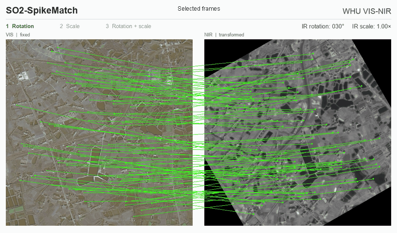
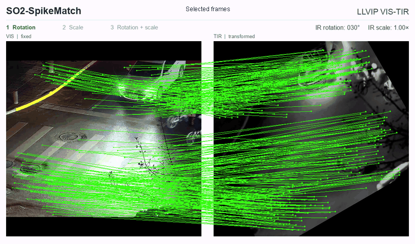

# SO2-SpikeMatch

### Infrared-visible image matching with rotation-equivariant spiking features

**旋转等变脉冲特征的红外可见光匹配**

SO2-SpikeMatch studies how spiking representations and directional geometry can work together for infrared-visible image matching. Differences in image formation make cross-modal appearance difficult to compare; large in-plane rotations further complicate orientation estimation and precise correspondence localization. The method combines direction-preserving spiking features, analytical orientation alignment, and quality-guided correspondence refinement.

## Main ideas

- **Direction-preserving spike coding.** Vector amplitudes are encoded through a radial integrate-and-fire process while continuous directions are retained. Under shared threshold and state conditions, the encoding is compatible with channel rotations.
- **Rotation-aware matching.** Directional descriptors support analytical relative-orientation estimation and alignment, alongside scalar contextual features.
- **Quality-guided localization.** Local descriptors and predicted correspondence geometry provide multiple orientation hypotheses. Localization-quality supervision guides their contributions, and a bounded residual refines the final coordinates.

The method uses a hybrid spiking representation with real-valued directional and contextual computations. Its focus is robust correspondence estimation under rotation.

## Qualitative demonstrations

The visible image stays fixed on the left; the infrared image on the right undergoes rotation, rescaling, and their combination. Fluorescent green lines display retained correspondences.

### WHU VIS-NIR

Visible / near-infrared matching.

[Open WHU VIS-NIR animation](SO2-SpikeMatch_WHU_VIS-NIR.gif)

### LLVIP VIS-TIR

Visible / thermal-infrared matching.

[Open LLVIP VIS-TIR animation](SO2-SpikeMatch_LLVIP_VIS-TIR.gif)

### Visualization protocol

These are selected qualitative examples from saved model predictions. Displayed lines have valid ground-truth correspondences and forward reprojection error strictly below **3 pixels**. Frames with fewer than **20** such correspondences were omitted: the WHU animation retains 154 of 192 frames, and the LLVIP animation retains 187 of 192 frames. The retained frames keep their original playback timing, so transformations may jump between frames. These animations illustrate selected matching behavior.

## 项目简介

SO2-SpikeMatch面向存在旋转变化的红外可见光图像匹配，将向量幅度的脉冲编码与连续方向分离，使编码后的方向特征仍可用于解析对齐；结合局部描述子与预测对应的几何关系构建多方向候选，并以定位质量监督候选加权和有界坐标细化。上方分别展示WHU VIS-NIR与LLVIP VIS-TIR上的筛选案例，可见光固定、红外图像旋转与缩放。

## Availability

This repository contains the project introduction and qualitative demonstration assets only. Source code, trained weights, and datasets are not included.

Project maintained by [Xinyu Gong](https://github.com/Xinyu-Gong).
